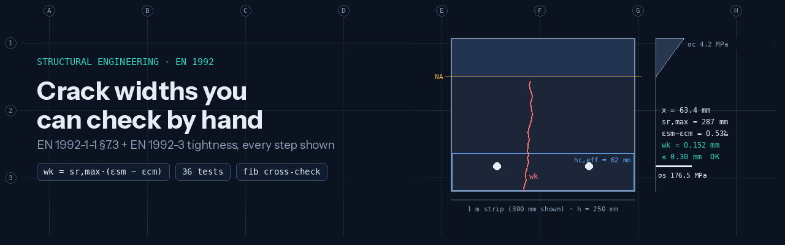
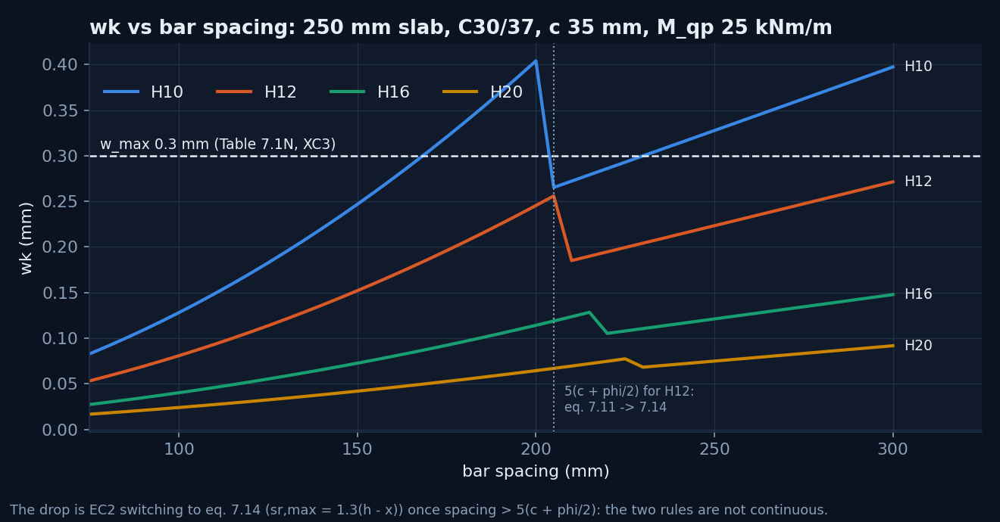
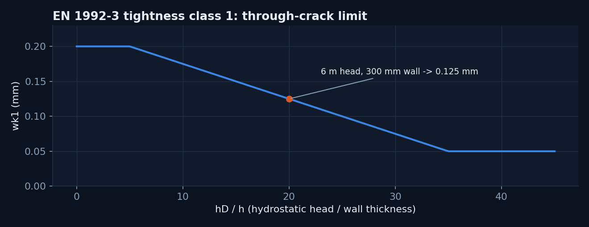
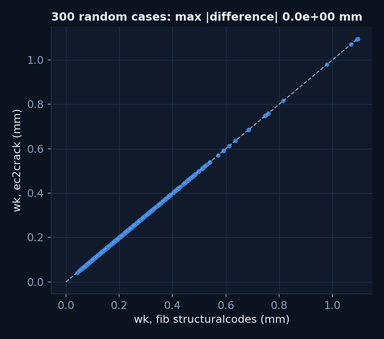

<p align="center"></p>

# ec2crack: transparent EN 1992 crack-width checks

[](https://github.com/mohamedragab4554/ec2-crack-width/actions/workflows/ci.yml)


`ec2crack` is a small, dependency-light Python package and CLI. It covers:
- crack widths and crack control to **EN 1992-1-1:2004 §7.3**;
- the liquid-retaining limits of **EN 1992-3:2006 §7.3.1**;
- comparing crack widths **measured on site or by a computer-vision pipeline** against those limits.

Every result carries its intermediate values, so it reads like a hand calculation that a checking engineer can follow line by line.

| | |
|---|---|
| **Type** | Open-source engineering tool (2026), built by Mohamed Ragab with AI pair-programming. Formulas implemented from the code text and verified as described below |
| **Why it exists** | My crack-detection work ([concrete-defect-detection-shm](https://github.com/mohamedragab4554/concrete-defect-detection-shm), [water-tank-crack-digital-twin](https://github.com/mohamedragab4554/water-tank-crack-digital-twin)) measures crack widths. This package answers the engineering question that follows: *is that width acceptable for this element?* |

## What it covers

| Clause | Function |
|---|---|
| Table 3.1 | `fcm`, `fctm` (including > C50/60), `Ecm`; eq. 7.20 effective modulus `Ec,eff = Ecm/(1+φ)` |
| Cracked elastic section | Neutral axis, `I_cr`, σs and σc for rectangular sections, with optional compression steel |
| 7.3.2 | Effective tension area `hc,eff` (bending / tension); eq. 7.1 minimum reinforcement `As,min` |
| 7.3.3 | Tables 7.2N and 7.3N (interpolated), eq. 7.6N bar-size modification |
| 7.3.4 | eq. 7.9 with the 0.6 σs/Es bound; eq. 7.11 / 7.14 crack spacing; eq. 7.12 equivalent diameter; **wk** eq. 7.8 |
| Table 7.1N | Recommended w_max by exposure class (quasi-permanent) |
| EN 1992-3 7.3.1 | Tightness classes 0–3; class 1 **wk1 = 0.20 → 0.05 mm for hD/h = 5 → 35** |
| Inspection | Measured widths vs limit and vs predicted wk → *within limit / review / exceeds limit* |

## Quick start

```bash
pip install -e ".[dev]"      # Python 3.10+; runtime dependency is only numpy
ec2crack wk --b 1000 --h 250 --cover 35 --bar 12 --spacing 150 --moment 25 --concrete C30/37 --exposure XC3
```

| Step | Clause | Value |
|---|---|---|
| Neutral axis | elastic, cracked | x = 63.4 mm |
| Steel stress | M = 25 kNm | σs = 176.5 MPa |
| Effective tension area | 7.3.2(3) | hc,eff 62.2 mm, ρp,eff 0.01212 |
| Mean strain difference | eq. 7.9 | 0.529×10⁻³ (0.6 σs/Es governs) |
| Maximum crack spacing | eq. 7.11 | sr,max = 287.3 mm |
| **Crack width** | eq. 7.8 | **wk = 0.152 mm** |
| Limit | Table 7.1N | 0.300 mm → **OK** (utilisation 0.51) |

The full hand calculation is in [docs/worked_example.md](docs/worked_example.md). The CLI exits with code 1 when a limit is exceeded, so it can gate a CI job or a batch script.

**A water tank wall** (EN 1992-3, tightness class 1: 6 m head, 300 mm wall):

```bash
ec2crack wk --b 1000 --h 300 --cover 40 --bar 16 --spacing 150 --moment 40 --concrete C32/40 --tightness 1 --head 6
# wk = 0.112 mm vs wk1 = 0.125 mm (hD/h = 20) -> OK, utilisation 0.90
```

**Checking measured cracks** (for example, the CSV written by the water-tank vision pipeline):

```bash
ec2crack assess examples/illustrative_widths.csv --limit 0.125 --predicted 0.112
```

The CSV in `examples/` is illustrative input for the command, not site measurements.

```python
from ec2crack import Concrete, RectangularSection, crack_width_section
r = crack_width_section(RectangularSection(b=1000, h=250, cover=35, bar=12, spacing=150),
                        Concrete.from_class("C30/37", creep=2.0), moment_kNm=25)
r.wk, r.sr_max_rule, r.eps_governed_by_minimum   # (0.152..., '7.11', True)
```

## Design insight: EC2's two spacing rules are not continuous



When bar spacing exceeds 5(c + φ/2), EN 1992-1-1 switches from eq. 7.11 to eq. 7.14 (sr,max = 1.3(h − x)). Just past the switch, **the predicted crack width drops**.

A naive optimiser would therefore recommend *wider* spacing to "reduce" cracks. For example, H10 fails at 170–200 mm but passes again at 205–225 mm.

`max_spacing_for_limit` scans upwards and stops at the first failure, so it never exploits the jump. A test pins this behaviour down.



## Verification

| Check | How | Result |
|---|---|---|
| Hand calculation | Worked example, every step asserted | [tests/test_hand_calculation.py](tests/test_hand_calculation.py) |
| Equilibrium | Force (C = T) and moment (T·z = M) equilibrium of the cracked section | Exact to 1e-9 |
| **Independent implementation** | 200 random cases against the fib [`structuralcodes`](https://github.com/fib-international/structuralcodes) EC2:2004 functions: hc,eff, ρp,eff, eq. 7.9, eqs. 7.11 / 7.14, wk, fctm, Ecm, Table 7.1N | Identical to floating-point precision |
| Behaviour | wk increases with moment and with spacing (within one spacing rule) | Tested |



36 tests run in under a second (`pytest -q`); CI runs them on Python 3.10 and 3.12.

## Scope and limits

- **Recommended values only.** National Annexes (for example the UK NA) can change w_max, k-factors and tightness limits. Check the NA that applies to the project.
- **Section types:** rectangular sections in bending or pure tension, high-bond or plain bars. Not covered: prestress (ξ1 bond terms), flanged sections, combined bending with axial force, and restraint cracking (EN 1992-3 Annex M / CIRIA C766).
- **Section stresses** use a linear-elastic cracked analysis with Ec,eff. The creep coefficient is an input: compute φ(∞, t0) to Annex B or take it from the project.
- **Measured vs calculated:**
  - wk is a characteristic design value at the reinforcement level.
  - A width measured at the surface, at one moment in time, is related to wk but not the same thing.
  - `assess` flags widths for engineering review; it does not make the judgement.
- This is an engineering aid. Results must be checked by a competent engineer before use in design or assessment.

## Structure

```
src/ec2crack/
  materials.py    Table 3.1, eq. 7.20          section.py    cracked elastic analysis
  crack.py        eqs. 7.8-7.14                limits.py     Table 7.1N, EN 1992-3 tightness classes
  simplified.py   Tables 7.2N/7.3N, eq. 7.1    design.py     largest compliant bar spacing
  inspection.py   measured vs limit            cli.py        `ec2crack` command
tests/            hand calc, structuralcodes cross-check, tools
scripts/make_figures.py   rebuilds docs/images
```

**Setup:**
- **Windows:** `py -3.11 -m venv .venv; .venv\Scripts\Activate.ps1; pip install -e ".[dev]"`
- **macOS / Linux:** `python3 -m venv .venv && source .venv/bin/activate && pip install -e ".[dev]"`

## References

- EN 1992-1-1:2004 *Eurocode 2: Design of concrete structures, Part 1-1*, §3.1, §7.3.
- EN 1992-3:2006 *Part 3: Liquid retaining and containment structures*, §7.3.1.
- fib, [`structuralcodes`](https://github.com/fib-international/structuralcodes), used as an independent test oracle (Apache-2.0; test dependency only).

---

Portfolio: **[mohamedragab4554.github.io](https://mohamedragab4554.github.io)**
